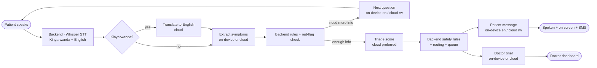

# Eleza — a voice-first hospital check-in that runs its AI on the kiosk

**Patients speak (Kinyarwanda or English). Doctors receive a structured brief before the patient walks in.**
Eleza uses **Firebase AI Logic hybrid inference** so clinical text is processed **on-device with Gemini Nano** whenever the kiosk can, and falls back to **Gemini in the cloud** when it can't — step by step, with safety rules the browser can't override.

|                        |                                                                                 |
| ---------------------- | ------------------------------------------------------------------------------- |
| **Demo video (3 min)** | _TODO: YouTube link_                                                            |
| **Live app**           | _TODO: Firebase Hosting URL_ — see [Try it](#try-it-judges)                     |
| **Platform**           | Web (Chrome desktop) · Firebase AI Logic + Gemini Nano                          |
| **Firebase**           | AI Logic (hybrid) · App Check · Remote Config (client **and** server) · Hosting |
| **License**            | [Apache 2.0](LICENSE)                                                           |

---

## The problem

In Rwanda there are fewer than 2 physicians per 10,000 people, and the hospitals most of us rely on are overcrowded. Patients queue for hours — sometimes four — for a five-minute consultation, and the doctor starts that consultation knowing nothing about them. Important symptoms are missed because there is no time to ask.

Digital intake tools exist, but they are **text-based**: they assume literacy, a keyboard and good internet. Rwanda's literacy rate is around 76%, while about 98% of people speak Kinyarwanda. A form excludes exactly the patients who wait the longest.

## What Eleza does

**1. Patient kiosk (voice only).** At the hospital entrance a patient presses one button and talks. They can speak in Kinyarwanda or English. Eleza greets them, asks for name, age, gender, phone and location, then asks **adaptive follow-up questions** about their symptoms — out loud, in their language. No typing, no reading required.

**2. Triage + routing.** When it has enough information, Eleza scores urgency (HIGH / MEDIUM / LOW), assigns a department and queue number, tells the patient where to go (spoken and on screen), and sends an SMS with their queue assignment.

**3. Doctor dashboard.** Before the patient walks in, the doctor sees a **structured brief**: chief complaint, symptoms, duration, severity, red flags, a short factual narrative, key findings, the full transcript and the audio clips. Hospital and platform admins manage facilities, doctors, rooms and queues.

Eleza is a **supervised support tool, not a diagnostic system**: it never names a disease or gives medical advice to the patient, and every brief is reviewed by a clinician.

<!-- TODO screenshots: kiosk with On-device/Cloud badges · completion screen · doctor brief · Remote Config console
  -->

---

## Why hybrid AI is the right design here

A hospital kiosk is a near-perfect case for on-device AI, and also a case where _pure_ on-device would be dangerous:

| Need                                 | How the hybrid design answers it                                                                                                                                                                                        |
| ------------------------------------ | ----------------------------------------------------------------------------------------------------------------------------------------------------------------------------------------------------------------------- |
| **Medical privacy**                  | Symptom extraction, follow-up questions, patient guidance and the doctor brief can run **inside Chrome on the kiosk** with Gemini Nano — the patient's words don't have to leave the device.                            |
| **Cost at scale**                    | On-device inference is free per call. A public hospital can't pay per token for every patient's every answer.                                                                                                           |
| **Unreliable hardware and networks** | Kiosks are often low-end machines. Every on-device step has a **deadline**; if Nano is missing, slow or failing, Firebase AI Logic answers from the cloud and the patient never notices.                                |
| **Kinyarwanda**                      | Gemini Nano is English-only. Eleza translates Kinyarwanda to English **in the cloud**, so the on-device steps only ever see English — and anything the patient _hears_ in Kinyarwanda is always generated in the cloud. |
| **Safety-critical triage**           | The triage score prefers the stronger cloud model, and the **backend re-checks every AI result** with deterministic rules (red flags, severity thresholds) that no model — on-device or cloud — can downgrade.          |

The result is not "on-device _or_ cloud" but a **per-step decision**, made for clinical reasons, and **changeable live from the Firebase console**.

---

## How it works



"On-device" means Gemini Nano in Chrome when available; "cloud" means Gemini in the cloud. Every step is a single Firebase AI Logic call that can take either path.

### The AI steps and where they run

Seven AI steps run **in the browser through Firebase AI Logic**. Speech-to-text runs on our backend with Whisper, including a model fine-tuned for Kinyarwanda speech.

| Step                   | What it does                                             | Default mode                                 | Why                                                 |
| ---------------------- | -------------------------------------------------------- | -------------------------------------------- | --------------------------------------------------- |
| Translation            | Kinyarwanda → English for clinicians and on-device steps | `only_in_cloud` (locked)                     | Nano doesn't read Kinyarwanda                       |
| Symptom extraction (B) | Structured fields from the conversation (JSON schema)    | `prefer_on_device`                           | Most sensitive text → keep it local when possible   |
| Follow-up question (C) | Next clarifying question                                 | `prefer_on_device` (en) · cloud (rw, locked) | Short, single-turn → ideal for Nano                 |
| Triage score (D)       | Priority, issue category, confidence                     | `prefer_in_cloud`                            | Safety-critical → stronger model first              |
| Routing suggestion     | Department when the issue is unclear                     | `prefer_in_cloud`                            | Rare, needs broader knowledge                       |
| Patient message (E)    | Calm next-step instructions, no diagnosis                | `prefer_on_device` (en) · cloud (rw, locked) | Patient-facing, in their language                   |
| Doctor brief (F)       | Factual narrative + key findings                         | `prefer_on_device`                           | Most sensitive output → keep it local when possible |

Every mode, the on-device deadline and the cool-down are **Remote Config parameters**. On our 8 GB test laptop, for example, we route extraction (which re-reads the whole conversation after every answer) to the cloud and keep the short single-turn steps on Nano — a change made in the console, with no redeploy.

---

## Technical implementation (Firebase AI Logic)

### 1. Hybrid inference through the Firebase JS SDK

FlutterFire's `firebase_ai` package doesn't support hybrid/on-device inference yet; the Firebase **JS SDK** does. Eleza therefore calls Firebase AI Logic from a small JS module that the Flutter web app uses through `dart:js_interop`:

- [`frontend/web/eleza_ai.js`](frontend/web/eleza_ai.js) — imports `firebase/ai` and builds the model with `getGenerativeModel(ai, { mode, onDeviceParams, inCloudParams })` ([line 83](frontend/web/eleza_ai.js#L83)), reads `response.inferenceSource` to know which path answered ([line 123](frontend/web/eleza_ai.js#L123)).
- It loads the **same SDK build as FlutterFire**, so it shares FlutterFire's Firebase app — and therefore its **App Check** token — instead of initialising a second app.
- Structured output works on both paths: a JSON schema is passed as `responseConstraint` on-device and `responseJsonSchema` in the cloud.
- [`frontend/lib/services/hybrid_ai_service.dart`](frontend/lib/services/hybrid_ai_service.dart) — typed Dart API over the bridge.
- [`frontend/lib/services/clinical_ai.dart`](frontend/lib/services/clinical_ai.dart) — the seven clinical steps, their prompts and schemas, and per-step routing ([`modeFor`](frontend/lib/services/clinical_ai.dart#L73)).

### 2. A fallback that respects a patient standing at a kiosk

`prefer_on_device` alone would wait for Nano however long it takes. Eleza adds ([`preferOnDeviceWithDeadline`](frontend/web/eleza_ai.js#L144)):

- **Deadline:** Nano gets a configurable budget (default 12 s). If it's exceeded, the on-device prompt is **aborted** (`AbortController`) and the same request is answered in the cloud.
- **Cool-down:** after a timeout, Nano is skipped for a while so one slow device doesn't make every step wait.
- **Warm-up:** the kiosk sends Nano a tiny prompt while the greeting plays, so the first real step doesn't pay the model's cold start.
- **Clean sessions:** on-device sessions are destroyed after each call, so a long-running kiosk doesn't accumulate them in memory.
- Every result carries a **trace** — step, `on_device`/`in_cloud`, mode, latency and fallback reason (`timeout`, `device_slow`, `device_unavailable`, `device_error`).

### 3. The browser is untrusted — the backend has the last word

AI runs in the patient's browser, so [the backend](backend/routers/kiosk_hybrid.py) treats every AI result as untrusted input:

- **Validates and caps** extraction fields; re-runs a **keyword red-flag check** on what the patient actually said ([`model_b._detect_red_flags`](backend/models/model_b.py#L73)).
- **Safety rules** ([`apply_safety_rules`](backend/models/model_d.py#L134)): a red flag, or patient-reported severity ≥ threshold, **forces HIGH priority** whatever the model said, and the doctor sees why ("Triage Safety Rule").
- **Vets the patient message** ([`vet_message`](backend/models/model_e.py#L153)): no disease names, no treatment advice; otherwise a safe template is used.

### 4. App Check

Required by Firebase AI Logic and activated before any AI call ([`main.dart`](frontend/lib/main.dart#L62)): the **debug provider** for local development, **reCAPTCHA** for the hosted build. Because the JS bridge shares FlutterFire's Firebase app, App Check covers the hybrid calls too.

### 5. Remote Config — as clinical governance, in two places

- **Client template (kiosk):** inference mode per step, on-device deadline and cool-down, all prompts, and whether the kiosk shows On-device/Cloud indicators ([`app_config.dart`](frontend/lib/services/app_config.dart), [`clinical_prompts.dart`](frontend/lib/services/clinical_prompts.dart)). Every value has an in-app default; invalid console values fall back to it.
- **Server template (backend):** the **triage safety thresholds** (low-confidence cutoff, maximum questions, severity that forces HIGH), read with the Firebase Admin SDK ([`server_config.py`](backend/server_config.py)). Safety thresholds live on the server — a browser can't change them — and are clamped to safe ranges.
- Ready-to-upload templates: [`firebase/remote-config/`](firebase/remote-config/).

### 6. Visible hybrid behaviour

With `kiosk_show_ai_details` on, the kiosk shows the Nano status and a live **On-device / Cloud** badge for each step, and the completion screen lists how every step was processed. The platform admin sees the same per-session trace on the patient page; the backend stores an `ai_summary` (on-device share, cloud fallbacks) with every brief.

### Firebase products used

| Product               | Used for                                                                                |
| --------------------- | --------------------------------------------------------------------------------------- |
| **Firebase AI Logic** | All 7 language steps, hybrid on-device (Gemini Nano) / cloud (Gemini)                   |
| **App Check**         | Protects every AI Logic call (debug provider locally, reCAPTCHA when hosted)            |
| **Remote Config**     | Client: per-step routing, timeouts, prompts, UI flag · Server: triage safety thresholds |
| **Hosting**           | The Flutter web app                                                                     |

---

## Try it (judges)

> **Best experience:** Chrome desktop **139+** with Gemini Nano enabled. Without Nano, everything still works — every step falls back to the cloud, which is exactly the hybrid behaviour.

1. **Enable Gemini Nano (optional):** open `chrome://flags/#prompt-api-for-gemini-nano-multimodal-input`, set **Enabled**, relaunch Chrome. The first use downloads the model.
2. **Open the app:** _TODO: Firebase Hosting URL_. Allow the microphone when asked.
3. **Patient kiosk:** on _"What will this device be used for?"_ choose **Patient Kiosk**, pick English or Kinyarwanda, press the button and describe a symptom, e.g. _"I have had a headache since yesterday."_ Answer the questions. Watch the **On-device / Cloud** badges.
   - Try a red flag: _"I have chest pain and I can't breathe"_ → Emergency, regardless of the model's score.
4. **Doctor view:** open `…/#/login` and sign in with the demo account below. Open the patient you just created to see the brief.

| Role                                            | Email                       | Password                           |
| ----------------------------------------------- | --------------------------- | ---------------------------------- |
| Doctor                                          | `doctor@eleza.demo`         | _see Devpost testing instructions_ |
| Hospital admin                                  | `hospital.admin@eleza.demo` | _same_                             |
| Platform admin (sees AI processing per session) | `platform.admin@eleza.demo` | _same_                             |

All demo data is fictional. Please use fake names and phone numbers.

> The speech-to-text backend runs on a GPU that sleeps when idle; the **first** request after a pause can take 1–2 minutes while Whisper loads.

---

## Run it yourself

**Prerequisites:** Flutter (Dart ≥ 3.7), Python 3.10+, a PostgreSQL database (e.g. a free [Neon](https://neon.tech) project), a Firebase project, and a GPU for Whisper (a free Colab T4 works).

### 1. Firebase project

1. Create a project and a **Web app**; enable **Firebase AI Logic** with the **Gemini Developer API**.
2. **App Check:** register the web app, then _Manage debug tokens_ → add a UUID (used as `APPCHECK_DEBUG_TOKEN`). For hosting, add a **reCAPTCHA** provider.
3. **Remote Config:** _Publish from a file_ → [`client-template.json`](firebase/remote-config/client-template.json) (Client) and [`server-template.json`](firebase/remote-config/server-template.json) (Server). Optional — the app has defaults.

### 2. Backend

Easiest: open [`backend/colab-test.ipynb`](backend/colab-test.ipynb) in Google Colab (T4 GPU), add the secrets it lists, **Run all**. It installs everything, prepares the database, starts the API and prints a public URL. Locally:

```bash
cd backend
pip install -r requirements.txt
cp .env.example .env          # fill in DB_*, HF_TOKEN, ELEVENLABS_API_KEY, JWT_SECRET_KEY
DEMO_PASSWORD='choose-one' python setup_db.py   # tables + demo accounts (safe to re-run)
uvicorn main:app --port 8000  # → http://localhost:8000/docs
```

Details: [backend/Readme.md](backend/Readme.md).

### 3. Frontend

```bash
cd frontend
cp firebase.env.example.json firebase.env.json   # Firebase web config, App Check debug token, API_BASE_URL
flutter pub get
flutter run -d chrome --dart-define-from-file=firebase.env.json
```

Details: [frontend/Readme.md](frontend/Readme.md).

No secrets are committed: Firebase config and API keys come from git-ignored files (`firebase.env.json`, `backend/.env`) or Colab secrets; the ElevenLabs key never reaches the browser (TTS is proxied by the backend).

---

## Testing

| What                                 | How                                                                                                                                                                     |
| ------------------------------------ | ----------------------------------------------------------------------------------------------------------------------------------------------------------------------- |
| **Each AI step, on-device vs cloud** | Debug builds include `/#/ai-smoke-test`: runs every clinical step and shows `source: on_device / in_cloud`, latency and fallback reason, plus the active Remote Config. |
| **Backend readiness**                | `GET /startup/status` → Whisper loaded, database connected, Remote Config values and their source.                                                                      |
| **API**                              | Swagger UI at `/docs`.                                                                                                                                                  |
| **Database setup**                   | `python setup_db.py` twice — the second run must report everything as already present.                                                                                  |
| **Full flow (manual)**               | English session, Kinyarwanda session, a red-flag session, then the doctor view — the checklist we used is in [`backend/Readme.md`](backend/Readme.md#testing).          |
| **Static checks**                    | `flutter analyze` (frontend).                                                                                                                                           |

---

## Built during the submission period (Nov 11 – Nov 30, 2026)

Eleza started before this hackathon as a voice pre-consultation prototype (Flutter kiosk + FastAPI backend, Whisper speech-to-text, server-side Gemini calls, PostgreSQL, doctor/admin dashboards, Twilio SMS). **During the hackathon we rebuilt its AI layer around Firebase AI Logic hybrid inference:**

- **Moved all language AI from the server into the browser** via a Firebase AI Logic JS bridge with per-step on-device / cloud routing (7 steps), including structured JSON output on both paths.
- **Added a Kinyarwanda → English cloud translation step** so on-device steps work for Kinyarwanda patients.
- **Deadline, cool-down and warm-up** around `prefer_on_device`, plus per-step traces (source, latency, fallback reason).
- **New backend contract** (`/kiosk/{id}/transcribe → /extraction → /score → /complete`) that treats AI results as untrusted: validation, red-flag re-check, severity safety rule, message vetting.
- **Firebase App Check** (debug + reCAPTCHA) and **Remote Config** on the client (routing, prompts, timeouts, UI) and on the server (triage thresholds via the Admin SDK).
- **On-device / Cloud indicators** for patients (configurable), admins and the stored brief.
- **Security:** Firebase config and keys moved out of the repo; ElevenLabs TTS moved behind a backend proxy.
- **Reliability and inclusion:** fresh-database setup script with demo accounts, reconnect after serverless-Postgres idle pauses, returning-patient handling, inclusive gender question (male, female, non-binary, other), Kinyarwanda wording fixes.

**Pre-existing / third-party work:** the Whisper models ([`openai/whisper-large-v3`](https://huggingface.co/openai/whisper-large-v3) and the community fine-tuned [`akera/whisper-large-v3-kin-200h-v2`](https://huggingface.co/akera/whisper-large-v3-kin-200h-v2)), ElevenLabs text-to-speech, Twilio SMS and the open-source libraries listed in `pubspec.yaml` and `requirements.txt`. AI coding assistants were used during development.

---

## Limitations and what's next

- **Gemini Nano speed depends on the kiosk's hardware.** On an 8 GB laptop, short steps run on-device in ~7 s while long prompts fall back to the cloud — Remote Config lets each hospital tune this per device class.
- **Kinyarwanda can't run on-device yet** (Nano is English-only), so Kinyarwanda patients' speech is translated in the cloud.
- **Next:** on-device speech-to-text so the kiosk keeps working during internet outages; a pilot with a Rwandan referral hospital; clinical review of the question trees with more doctors.

## Team

**Benitha Uwituze Rutagengwa** — solo developer (product, AI pipeline, backend, frontend). Designed with feedback from community users, an academic supervisor and two Rwandan medical doctors.

## License

[Apache License 2.0](LICENSE)
